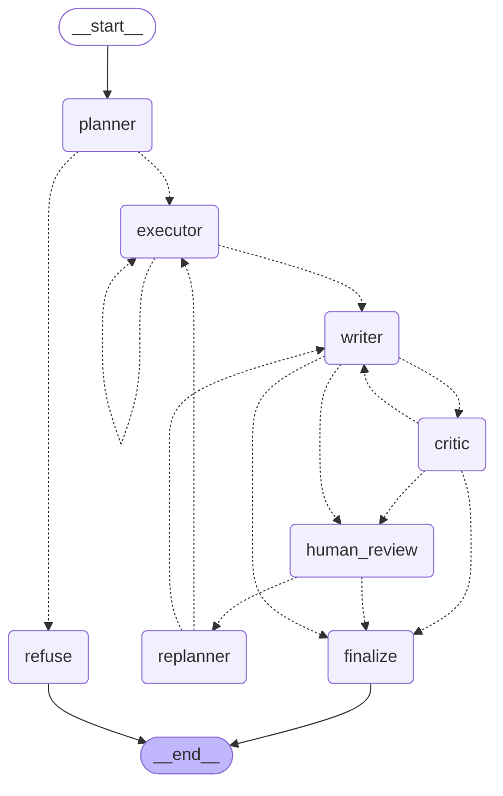

# Company Research Agent

[](https://github.com/Shrey-Vhr/company-research-agent/actions/workflows/ci.yml)

A LangGraph research agent that answers questions about TCS, Infosys and Wipro from their financials and FY2025-26 annual reports, with page citations.


## What it does

- Fetches yearly financials (revenue, operating income, net income, debt, equity in ₹ crore) from Yahoo Finance and searches the three FY2025-26 annual reports.
- Cites the source with every figure: the report's PDF page, or the data source and year. It does not give investment advice, and every answer ends with a disclaimer.
- Pauses for your approval: you can approve the draft or ask for changes before the report is final.

Example question: *What key risks does Infosys name?*

> Infosys names these key and emerging risks:
>
> - Geopolitical, macroeconomic or health events, including uncertainty around tariffs and trade restrictions (Infosys Annual Report FY2025-26, p. 132).
> - Artificial intelligence, Global Capability Centers (GCCs), technology disruption and innovation, and talent supply constraints (Infosys Annual Report FY2025-26, p. 133).
> - …
>
> This is for information only and is not investment advice.

(Excerpt of a real `graph_full` answer from the eval run `2026-11-01_195047`. Page numbers are PDF pages, not the numbers printed on the report pages.)

## How it works



- **planner:** one model call decides whether the question is in scope and, if so, writes 2-6 steps.
- **executor:** runs one plan step per visit with the three tools (`get_financials`, `calculate`, `search_reports`) and appends each result to the evidence.
- **writer:** drafts the report from the numbered evidence only, and rewrites it when the critic or the human gives feedback.
- **critic:** a code check that every number in the draft appears in the evidence, plus a model check of names, facts, citations, advice and disclaimer; a failed draft goes back to the writer up to 2 times.
- **human_review:** pauses the run (`interrupt()`) so a person can approve the draft or type a change request.
- **replanner:** turns a change request into only the extra steps needed, then sends the run to the executor (new facts) or straight to the writer (wording only).
- **refuse:** writes a fixed refusal for out-of-scope questions (advice, predictions, other companies) and ends the run.
- **finalize:** sets the final report, adding a note with the critic's remaining problems if it never passed.

State is saved in a SQLite checkpointer, so a run paused at review can be resumed after a restart.

## Results

Three versions on the same 20 questions, each question run 3 times (60 runs per version): the hand-written `raw` loop, the graph without the critic, and the full graph. 11 questions are numbers, scored by code; 9 are text, names or refusals, graded by hand.

| version | strict (of 60) | %-tolerant (of 60) | avg seconds | avg cost per question |
|---|---|---|---|---|
| raw | 57 | 57 | 6.0 | $0.0006 |
| graph_no_critic | 54 | 60 | 16.0 | $0.0017 |
| graph_full | 58 | 60 | 22.9 | $0.0028 |

Strict is the original scorer. %-tolerant also accepts a ratio written as a percentage (0.229 as "22.9%") on the two debt-to-equity questions. Cost is computed from token counts with prices set in `evals/summarize.py`. Full tables: `evals/results/summary_2026-11-01_195047.md`.

What the numbers show:

- **The graph's clear win is refusing out-of-scope companies.** On "What was HCLTech's revenue in FY2025-26?" the raw agent gave a figure about 100x too high in 3 of 3 runs. Both graph versions refused in 3 of 3 runs. This is the only question where the raw agent failed. The eval ran before a v1.0 fix (F06): `get_financials` now rejects tickers outside TCS, INFY and WIPRO, so the raw agent also refuses this question today.
- **The critic added no measurable factual accuracy.** With the %-tolerant score, `graph_no_critic` and `graph_full` both get 60/60. The strict gap comes from format: `graph_no_critic` wrote debt-to-equity as percentages in 6 of 6 runs, and `graph_full` fixed that on q09 (3 of 3) but only partly on q10 (1 of 3 strict). The raw agent also scored 57/60 on both scores.
- **The full graph costs about 4.7x the raw agent** per question ($0.0028 vs $0.0006) and takes 3.8x as long (22.9 s vs 6.0 s); **the critic alone** adds about 1.6x cost and 1.4x time over the graph without it ($0.0017, 16.0 s).
- **The 27 text grades were drafted by Claude Code and reviewed by hand** (27 of 27 agreed). They are not independent of Claude's judgement.
- **The eval ran with `auto_approve`,** so the human-review and replanner path was not part of it.

Hand-found failures and their fixes: [evals/FAILURES.md](evals/FAILURES.md).

## Tech stack

- Python 3.14, LangChain (`ChatOpenAI`, tool binding) and LangGraph (graph, SQLite checkpointer, `interrupt`)
- OpenAI chat and embedding models, named in `.env`
- Chroma vector store; PyMuPDF for the PDFs
- yfinance for financials
- Streamlit UI; Docker; GitHub Actions (ruff + pytest); LangSmith tracing (optional)

## Quickstart

```bash
git clone https://github.com/Shrey-Vhr/company-research-agent.git
cd company-research-agent
cp .env.example .env          # then fill in OPENAI_API_KEY, LLM_MODEL, EMBEDDING_MODEL
pip install -r requirements.txt
```

In `.env`, put no quotes around values (Docker's `--env-file` keeps them).

Download the three annual-report PDFs into `data/reports/`. File names and source URLs are in [docs/DATA_SOURCES.md](docs/DATA_SOURCES.md) (`tcs_fy2026.pdf`, `infy_fy2026.pdf`, `wipro_fy2026.pdf`). Then build the index and start the app:

```bash
python -m scripts.build_index   # shows the estimated embedding cost and asks y/n
streamlit run app.py
```

Command line, without the app: `python -m research_agent.graph.run "question"` (add `--auto` to skip human review).

### Docker

`data/` (PDFs, index, SQLite files) must already exist, so build the index first. The image holds no keys and no data.

```bash
docker build -t company-research-agent .
docker run --rm -p 8501:8501 --env-file .env -v "$PWD/data:/app/data" company-research-agent
```

On Windows PowerShell use `${PWD}` instead of `$PWD`. The app is at http://localhost:8501.

## Design decisions

- **LangGraph instead of one tool loop:** separate nodes can be tested alone, and a critic and a human pause need explicit control flow. The raw loop stays as the baseline. ([DECISIONS.md](DECISIONS.md), 2026-10-27)
- **The critic has a code check and a model check:** numbers can be matched exactly, while names and "does this page say this" need a model. ([DECISIONS.md](DECISIONS.md), 2026-10-27)
- **Chunks of 1,600 characters instead of 3,200:** retrieval hit rate went from 3/6 to 4/6 on a small test set. ([DECISIONS.md](DECISIONS.md), 2026-10-24)
- **Eval answer key accepts both yfinance and report values,** and results report a strict and a %-tolerant score side by side. ([DECISIONS.md](DECISIONS.md), 2026-10-29 and 2026-11-01)

## Limitations

- Only three companies (TCS, Infosys, Wipro) and one year of annual reports (FY2025-26).
- Financials come from yfinance, which is unofficial. Infosys figures are converted from USD and are about 0.3-0.6% off the report.
- TCS tables extract badly (₹ shown as "H", split words and numbers), so table numbers lose their row and column labels.
- Retrieval is weak on short exact facts such as a CEO's name; a keyword search is the planned fix.
- Cost: every question calls the model many times. The full graph averaged about $0.0028 per question in the eval, and the 20-run daily cap in the app is shared by all users.
- The critic's number check compares numbers only, not what they mean.

## Roadmap

- v1.1: upload a PDF and ask about any company.
- Hybrid search (keyword + vector) for retrieval.

## Disclaimer

This is a research tool, not investment advice. Check any figure against the source report before relying on it.

License: MIT.

## How it was built

I designed the agent and its evaluation: the graph, the prompts, the critic and grounding rules, the retrieval choices, and the eval questions and scoring. Code was written with AI help: some core pieces I adapted from an AI tutor's examples, and Claude Code wrote the data plumbing, Docker, CI and UI layout. I reviewed, tested and can explain every part, and the failures I found and fixed are in evals/FAILURES.md.
